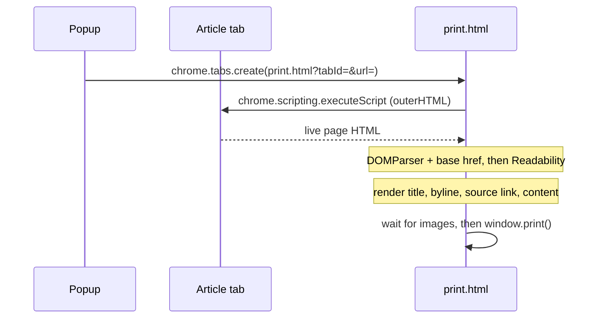

# PDF Module (article export)

Exports the article of the current tab to PDF.

- Reads the tab's live DOM, so text shown only to a logged-in subscriber is
  kept: the page is not fetched again.
- [`@mozilla/readability`](https://github.com/mozilla/readability) (Firefox
  Reader View) keeps the main article and drops navigation, ads and teasers.
- The article opens in a clean extension page (`print.html`) that calls
  `window.print()` once its images have loaded. Pick "Save as PDF" as the
  destination; the article title is the suggested file name.
- No settings, no storage.

## Flow

## Known limitations

- The PDF comes from the print dialog, not a direct download (that would need
  the `debugger` permission and its warning bar).
- Content the page loads only on scroll (infinite scroll, some lazy images
  without `data-src`) is missing unless it was scrolled into view first.
- Readability can miss the article on unusual layouts: the page then shows
  "No article found on this page".
