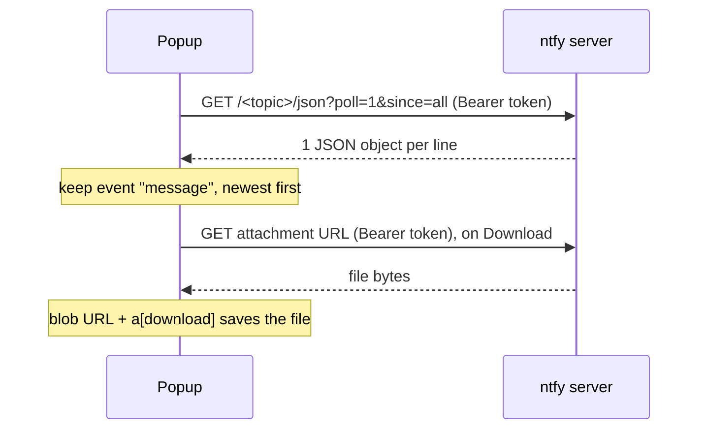

# ntfy Module

Lists the messages of an ntfy topic (`kbsali-all` by default) from a
self-hosted or public ntfy server.

- URLs in a message body are links; a message `click` URL shows as "Open link".
- An attachment shows as a "Download" button, or as "expired" once the server
  dropped it.
- Refresh re-polls; nothing runs in the background.

## Storage shape

`ntfy: { server, topic, token }` under the root `omni` key in
`chrome.storage.sync`. `token` is an ntfy access token (`tk_...`), empty for a
public topic. It syncs with the other settings to every browser signed in to
the same Chrome profile.

## Flow

## Known limitations

- Shows what the server still caches (`cache-duration`, 12 h by default).
- No live subscription, no unread badge, no publishing.
- Only `http(s)` `click` URLs are shown.
